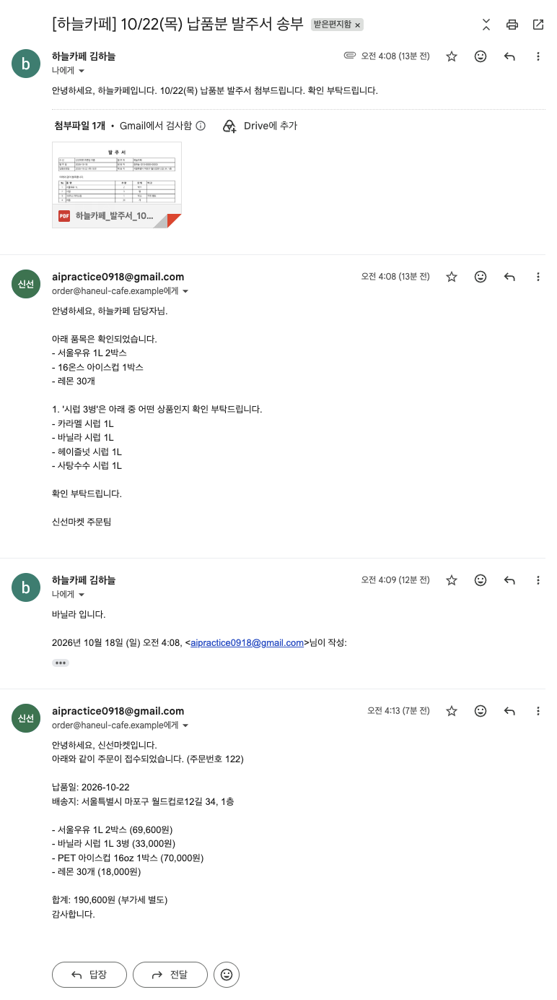
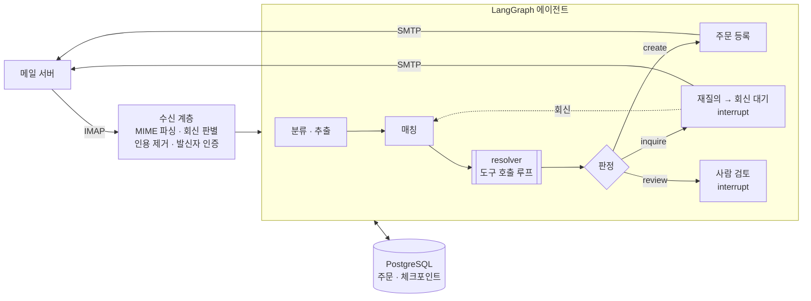
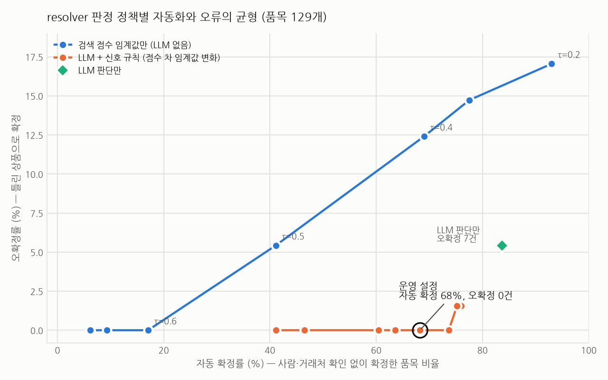
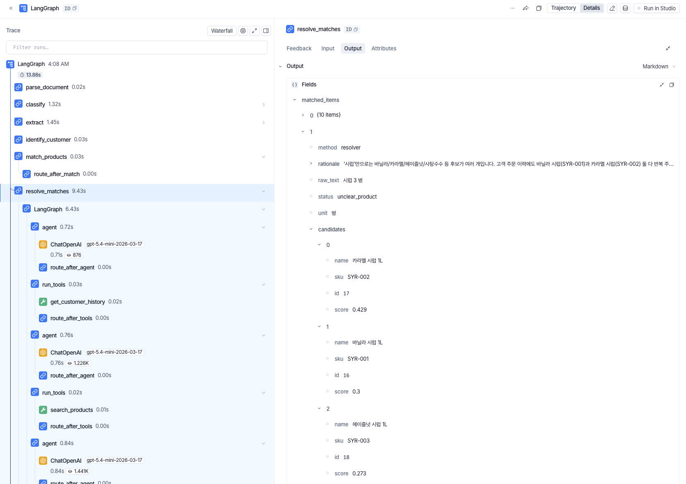

# Order Intake Agent

이메일·PDF·엑셀로 들어오는 B2B 발주를 읽고, 상품을 매칭하고, 주문을 등록하는 LangGraph 에이전트.
정보가 부족하면 거래처에 되묻고 회신을 받아 이어서 처리하며, 내부 판단이 필요한 건은 사람에게 넘긴다.



<sub>실제 Gmail 계정으로 시연한 스레드. 거래처가 PDF 발주서를 보내자 에이전트가 애매한 품목("시럽")을 선택지와 함께 되묻고, "바닐라"라는 회신을 받아 같은 스레드에서 주문을 확정했다. (개인 정보는 화면 표시만 가상 정보로 바꿨다)</sub>

## 무엇을 하나

- **읽기**: 메일 본문, PDF·엑셀 첨부를 구조화한다 (품목·수량·단위·납기·배송지)
- **매칭**: "16온스 아이스컵", "바닐나 시럽" 같은 자유 표현을 상품 마스터에 연결한다. 정확히 일치하지 않으면 도구를 쓰는 서브에이전트가 검색·거래처 주문 이력을 조사한다
- **판단**: 문제가 없으면 주문 등록, 거래처만 답할 수 있으면 재질의, 내부 판단이 필요하면 사람 검토
- **이어가기**: 재질의 메일에 대한 회신이 오면 멈춰 있던 처리를 그대로 재개한다 (서버를 재시작해도)

## 결과

| 평가 | 규모 | 결과 |
|---|---|---|
| 전체 평가셋 (깨끗한·지저분한 발주, 비발주, 프롬프트 인젝션, 재질의·검토 시나리오) | 77건 | 결정·주문 내용 전부 정답, **오등록 0건** |
| hold-out (개선에 쓰지 않은 케이스) | 12건 | 전부 정답, 오등록 0건 |
| 품목 매칭 벤치마크 (판정 정책 비교) | 129개 | 운영 정책: 자동 확정 68%, **오확정 0건** |
| 실제 Gmail 연동 | 시연 | 본문 발주, PDF 발주 → 재질의 → 회신 → 주문 확인 |

건당 평균 2,600 토큰, 4.5초, $0.0025 (gpt-5.4-mini / nano).
평가셋이 작고 케이스와 시스템을 같은 작성자가 만들었다는 한계가 있다 → [평가 방법과 한계](docs/evaluation.md)

## 아키텍처



자세한 구조: [docs/architecture.md](docs/architecture.md)

## 핵심 설계 판단

**1. 고정 워크플로우 + 불확실한 두 구간에만 에이전트 루프**
전체 흐름은 예측 가능한 그래프로 두고, 케이스마다 조사 방법이 달라지는 "애매한 품목 매칭"과 사람과 비동기로 주고받는 "재질의"에만 루프를 넣었다. 주문 등록은 항상 결정적 코드가 하고, LLM에는 쓰기 권한이 있는 도구를 주지 않는다.

**2. LLM의 선택을 그대로 믿지 않는다 — 관측 가능한 신호로 최종 판정**
resolver가 상품을 골라도 "검색 후보에 있는가, 거래처가 주문한 적 있는가, 점수 차가 충분한가, 비슷한 이력 상품이 경쟁하는가"를 규칙으로 확인한다. 129개 벤치마크에서 LLM 판단만 쓰면 자동 확정 84%에 오확정 7건, 검색 점수만 쓰면 오확정 0이 되는 지점의 자동 확정이 17%였다. LLM + 규칙은 오확정 0건으로 68%.



**3. "누가 해결할 수 있는가"로 분기**
납기 누락·미취급 상품·애매한 품목처럼 거래처만 답할 수 있는 문제는 재질의, 재고 부족·발신자 미확인처럼 내부 판단이 필요한 문제는 사람 검토. 질문 구성은 코드가, 메일 문장만 LLM이 쓴다.

**4. 판단 과정을 남기고 측정하며 개선**
모든 노드·LLM·도구 호출을 LangSmith로 추적하고, 기능을 붙일 때마다 평가셋으로 수치를 기록했다 ([개선 이력](docs/eval-log.md)). 정답이 프롬프트 예시에 새는 문제, 회신 단위 해석 버그, 사람이 메일함을 함께 볼 때 회신을 놓치는 폴러 결함도 이 과정에서 찾았다.



**5. 외부 입력은 신뢰하지 않는다**
메일 본문의 지시문은 따르지 않고(인젝션 케이스 3건 정상 처리), From 주소는 위조 가능하므로 수신 서버의 SPF/DKIM/DMARC 결과가 실패면 등록 거래처라도 검토로 보낸다. 상호명만으로 식별한 발신자도 자동 등록하지 않는다.

## 한계와 다음 단계

- 평가셋 77건·hold-out 12건은 작고, 대부분 같은 작성자(시스템 개발자와 LLM)가 만들었다. 실제 발주 데이터로 검증하지 않았다
- 스캔본·사진 첨부(OCR), `.xls`·`.hwp` 첨부는 아직 지원하지 않는다
- 답장이 아닌 새 메일로 온 회신은 스레드에 연결하지 못한다. 문서의 상호와 발신 거래처가 다른 경우를 검사하지 않는다
- resolver는 루프마다 대화 전체를 다시 보내 입력 토큰이 크다 (비용 최적화 여지)

## 실행

```bash
cp .env.example .env                 # LLM 키 등 설정 (OpenAI 또는 로컬 Ollama)
uv sync
docker compose up -d --build         # PostgreSQL + API (localhost:8000)
uv run python -m app.db.seed         # 스키마 + 시드 (상품 40, 거래처 15, 과거 주문 120)

uv run python -m evals.run --runner graph --tag mytest   # 전체 평가 (DB를 시드 상태로 초기화함)
uv run pytest

# 메일 원본으로 직접 넣기 (회신도 같은 엔드포인트)
curl -X POST localhost:8000/intake -H 'Content-Type: message/rfc822' --data-binary @order.eml
```

실제 Gmail 연동: [docs/mail-integration.md](docs/mail-integration.md)

| API | 설명 |
|---|---|
| `POST /intake` | 메일 원본(.eml) 수신. 새 발주는 처리 시작, 재질의 회신은 기존 스레드 재개 |
| `GET /intake/{id}` | 처리 상태와 보낸 메일(재질의·주문 확인) |
| `GET /reviews`, `POST /reviews/{id}/resolve` | 사람 검토 목록, 승인(수정 포함)·재질의 요청·거절 |
| `POST /orders`, `GET /orders/{id}`, `GET /products?q=` | Mock ERP (멱등성 키, 재고 차감) |

**기술 스택**: Python 3.13 · LangGraph (PostgresSaver) · FastAPI · PostgreSQL (pg_trgm) · OpenAI gpt-5.4-mini/nano (Ollama 로컬 모델로 교체 가능) · LangSmith · Docker Compose

## 문서

| 문서 | 내용 |
|---|---|
| [docs/architecture.md](docs/architecture.md) | 그래프 구조, 노드 역할, 수신 계층 경계, 상태·체크포인트 |
| [docs/evaluation.md](docs/evaluation.md) | 평가셋 구성, 라벨링 기준, 지표, 버전별 수치, hold-out, 임계값 실험 |
| [docs/mail-integration.md](docs/mail-integration.md) | Gmail IMAP/SMTP 연동과 안전장치 |
| [docs/eval-log.md](docs/eval-log.md) | 날짜순 개선 기록 (가설 → 변경 → 수치 → 남은 실패) |
| [order-intake-agent-design.md](order-intake-agent-design.md) | 초기 설계 문서 (구현하며 갱신) |
