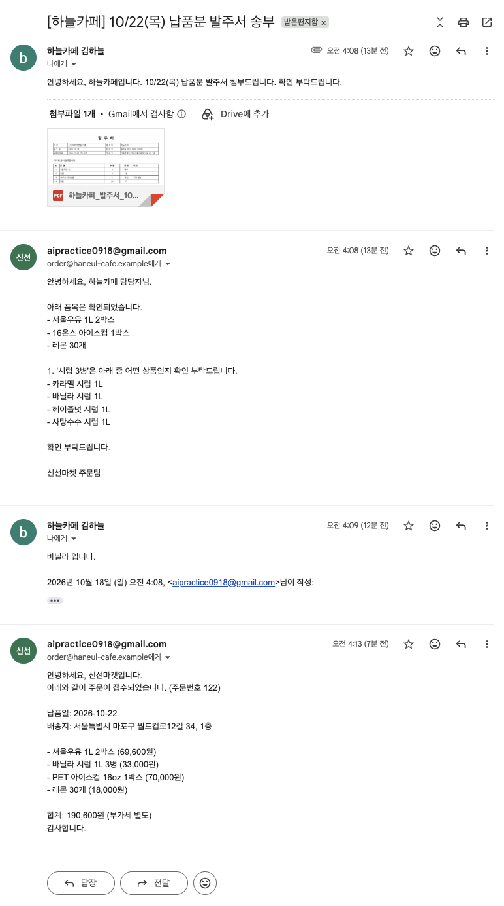
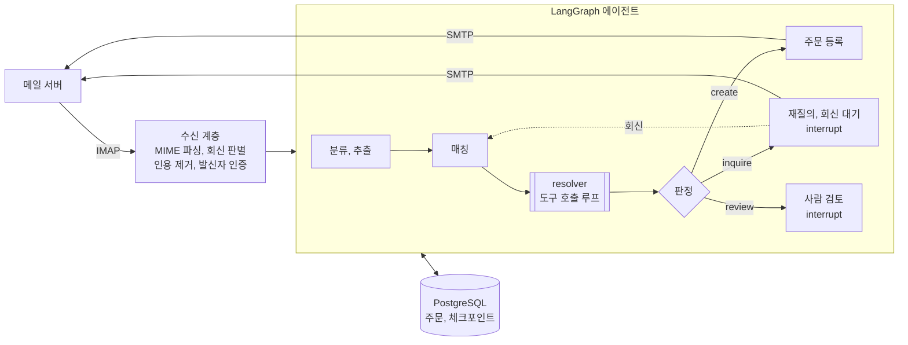
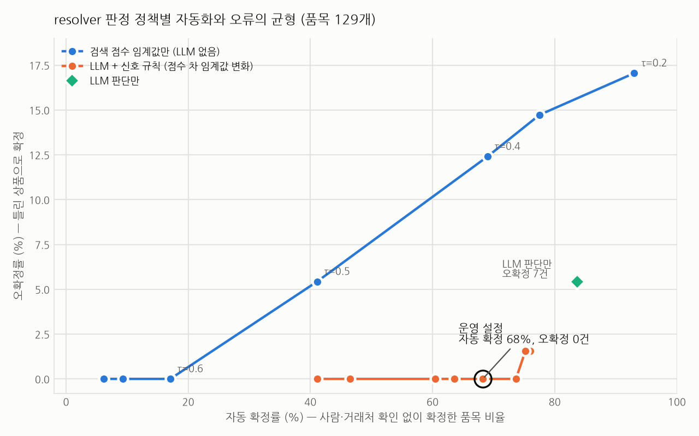
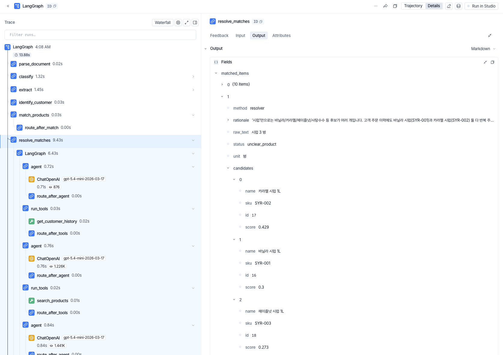

# Order Intake Agent

이메일, PDF, 엑셀로 들어오는 B2B 발주를 읽어서 상품을 매칭하고 주문까지 등록하는 LangGraph 에이전트입니다.
정보가 부족하면 거래처에 다시 물어보고 회신을 받아 이어서 처리하고, 내부에서 판단해야 하는 건은 담당자에게 넘깁니다.

<p align="center"></p>

<sub>실제 Gmail로 돌려본 스레드입니다. PDF 발주서의 "시럽"이 어떤 상품인지 애매해서 후보를 붙여 물어봤고, "바닐라"라는 답을 받아 같은 스레드에서 주문을 확정했습니다. (개인 정보는 가상으로 바꿨습니다)</sub>

## 하는 일

- 메일 본문과 PDF, 엑셀 첨부에서 품목, 수량, 단위, 납기, 배송지를 뽑습니다.
- "서울우유1000ml", "카라멜 소스 큰거", "식물성휘핑"처럼 거래처마다 다르게 쓰는 품목명을 상품 마스터와 연결합니다. 이름만으로 상품을 특정할 수 없으면 resolver가 상품 검색 결과와 거래처의 과거 주문 이력을 참고해 고릅니다.
- 문제가 없으면 주문을 등록하고, 거래처만 답할 수 있는 건 다시 묻고, 내부 판단이 필요한 건 검토로 넘깁니다.
- 재질의에 회신이 오면 멈췄던 지점부터 이어서 처리합니다. 서버를 재시작해도 마찬가지입니다.

## 결과

| 평가 | 규모 | 결과 |
|---|---|---|
| 전체 평가셋 (정상/지저분한 발주, 비발주, 프롬프트 인젝션, 재질의와 검토 시나리오) | 77건 | 결정과 주문 내용 모두 정답, 오등록 0건 |
| hold-out (개선 과정에서 안 본 케이스) | 12건 | 모두 정답, 오등록 0건 |
| 품목 매칭 벤치마크 | 129개 | 자동 확정 68%, 오확정 0건 |
| 실제 Gmail | 시연 | 본문 발주, PDF 발주에서 재질의와 회신을 거쳐 주문 확인까지 |

건당 평균 2,600 토큰, 4.5초, $0.0025 정도 듭니다 (gpt-5.4-mini/nano 기준).
평가셋이 작고 케이스와 시스템을 같은 사람이 만들었다는 한계가 있습니다. 자세한 내용은 [평가 방법과 한계](docs/evaluation.md)에 정리했습니다.

## 아키텍처



자세한 구조는 [docs/architecture.md](docs/architecture.md)에 있습니다.

## 설계하면서 정한 것들

### 흐름은 고정하고, 루프는 두 군데에만

전체 흐름은 고정된 그래프로 두고, 케이스마다 찾아볼 게 달라지는 품목 매칭과 거래처와 메일을 주고받는 재질의에만 루프를 넣었습니다. 주문 등록은 코드가 직접 하고, LLM에는 쓰기 권한이 있는 도구를 주지 않았습니다.

### resolver가 고른 상품은 규칙으로 한 번 더 확인

resolver가 상품을 골라도 바로 확정하지 않습니다. 검색 후보에 있는 상품인지, 거래처가 주문한 적이 있는지, 점수 차이가 충분한지, 헷갈릴 만한 이력 상품이 없는지를 확인합니다. 129개 벤치마크에서 비교한 결과입니다.

| 정책 | 자동 확정 | 오확정 |
|---|---|---|
| LLM 판단만 사용 | 84% | 7건 |
| 검색 점수만 사용 (오확정 0이 되는 임계값) | 17% | 0건 |
| LLM + 규칙 (현재) | 68% | 0건 |



### 누가 답할 수 있는지에 따라 분기

납기 누락, 미취급 상품, 애매한 품목은 거래처에 물어보고, 재고 부족이나 발신자 미확인은 내부 검토로 보냅니다. 무엇을 물을지는 코드가 정하고, LLM은 메일 문장만 씁니다.

### 추적하고 측정하면서 고치기

노드, LLM, 도구 호출을 전부 LangSmith로 추적하고, 기능을 바꿀 때마다 평가셋 수치를 남겼습니다 ([개선 이력](docs/eval-log.md)). 정답이 프롬프트 예시에 섞여 들어가던 문제, 회신의 단위를 잘못 읽던 버그, 메일함을 사람이 같이 열어보면 회신을 놓치던 폴러 버그를 이렇게 찾았습니다.



### 외부 입력은 그대로 믿지 않기

메일 본문에 들어 있는 지시문은 따르지 않습니다 (인젝션 케이스 3건 통과). From 주소는 위조할 수 있어서, 수신 서버의 SPF/DKIM/DMARC 검사가 실패하면 등록된 거래처라도 검토로 보냅니다. 상호명만으로 식별한 발신자도 자동 등록하지 않습니다.

## 한계

- 평가셋(77건, hold-out 12건)이 작고 대부분 제가 LLM과 함께 만들었습니다. 실제 발주 데이터로는 검증하지 못했습니다.
- 스캔본이나 사진(OCR), `.xls`, `.hwp` 첨부는 아직 지원하지 않습니다.
- 답장이 아니라 새 메일로 온 회신은 기존 스레드에 연결하지 못합니다. 문서에 적힌 상호와 실제 발신 거래처가 다른지도 아직 검사하지 않습니다.
- resolver가 루프를 돌 때마다 대화 전체를 다시 보내서 입력 토큰이 많습니다.

## 실행

```bash
cp .env.example .env                 # LLM 키 등 설정 (OpenAI 또는 로컬 Ollama)
uv sync
docker compose up -d --build         # PostgreSQL + API (localhost:8000)
uv run python -m app.db.seed         # 스키마 + 시드 (상품 40, 거래처 15, 과거 주문 120)

uv run python -m evals.run --runner graph --tag mytest   # 전체 평가 (DB를 시드 상태로 초기화함)
uv run pytest

# 메일 원본으로 직접 넣기 (회신도 같은 엔드포인트)
curl -X POST localhost:8000/intake -H 'Content-Type: message/rfc822' --data-binary @order.eml
```

실제 Gmail 연동 방법은 [docs/mail-integration.md](docs/mail-integration.md)를 참고하세요.

| API | 설명 |
|---|---|
| `POST /intake` | 메일 원본(.eml) 수신. 새 발주면 처리 시작, 재질의 회신이면 기존 스레드 재개 |
| `GET /intake/{id}` | 처리 상태와 보낸 메일(재질의, 주문 확인) |
| `GET /reviews`, `POST /reviews/{id}/resolve` | 검토 목록. 승인(수정 포함), 재질의 요청, 거절 |
| `POST /orders`, `GET /orders/{id}`, `GET /products?q=` | Mock ERP (멱등성 키, 재고 차감) |

기술 스택: Python 3.13, LangGraph (PostgresSaver), FastAPI, PostgreSQL (pg_trgm), OpenAI gpt-5.4-mini/nano (Ollama 로컬 모델로 교체 가능), LangSmith, Docker Compose

## 문서

| 문서 | 내용 |
|---|---|
| [docs/architecture.md](docs/architecture.md) | 그래프 구조, 노드 역할, 수신 계층 경계, 상태와 체크포인트 |
| [docs/evaluation.md](docs/evaluation.md) | 평가셋 구성, 라벨링 기준, 지표, 버전별 수치, hold-out, 임계값 실험 |
| [docs/mail-integration.md](docs/mail-integration.md) | Gmail IMAP/SMTP 연동과 안전장치 |
| [docs/eval-log.md](docs/eval-log.md) | 날짜순 개선 기록 (가설, 변경, 수치, 남은 실패) |
| [order-intake-agent-design.md](order-intake-agent-design.md) | 초기 설계 문서 (구현하면서 갱신) |
