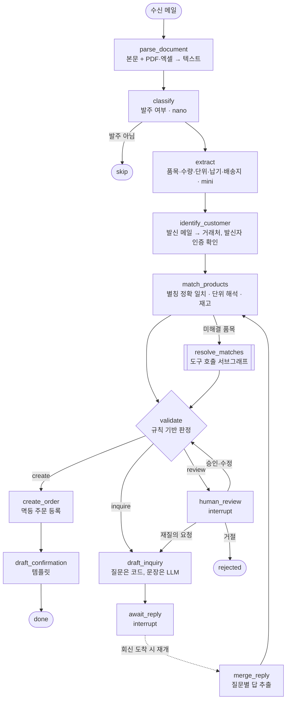

# 아키텍처

[← README](../README.md)

## 전체 흐름



LLM을 쓰는 노드는 classify, extract, resolve_matches, draft_inquiry, merge_reply 다섯 곳이다. 조회·검증·주문 등록·주문 확인 문구는 결정적 코드가 맡는다.

## 수신 계층과 에이전트의 경계

판단이 필요 없는 메일 형식 처리는 수신 계층(`app/ingest`, `app/mail`), 판단이 필요한 처리는 그래프에 둔다.

| 단계 | 위치 | 이유 |
|---|---|---|
| 메일 수신(IMAP), MIME 파싱, 첨부 저장 | 수신 계층 | 형식 처리. 재시도·중복 수신은 인프라 영역 |
| 같은 Message-ID 중복 수신 무시 | 수신 계층 | 결정적 |
| 회신 판별: `In-Reply-To`/`References`가 우리가 보낸 메일 또는 원래 발주를 가리키면 기존 스레드 재개 | 수신 계층 | DB 조회로 끝남 |
| 회신 본문의 인용된 이전 메일 제거 | 수신 계층 | 인용된 원래 품목을 다시 읽어 중복 주문하는 것을 방지 |
| 발신자 인증 결과(SPF/DKIM/DMARC) 해석 | 수신 계층 → 그래프는 결과만 사용 | 수신 서버(`mx.google.com`)가 붙인 헤더만 신뢰 |
| 첨부 내용 → 텍스트 | 그래프 (`parse_document`) | 추후 멀티모달 OCR이 들어갈 자리. 추적·재시도에 포함되도록 |
| 재질의·주문 확인 메일 발신(SMTP) | 수신 계층 | 저장해 둔 Message-ID로 보내야 회신이 같은 스레드로 돌아온다 |

## 매칭: 정확 일치 → resolver → 신호 규칙

1. **정확 일치** (`match_products`): 거래처 전용 별칭 → 공용 별칭 → 정식 명칭. 공백·대소문자 무시
2. **단위 해석**: 원문 단위 정규화(`box`·`박스로요`·`박스 (12개입)` → 박스), 없으면 그 거래처의 주문 이력 단위, 이력도 없고 박스 판매 상품이면 거래처에 확인
3. **resolver** (정확 일치 실패 품목만): LLM이 읽기 전용 도구를 최대 5회 호출하고 `submit_resolution`으로 결론(match / ask_customer / not_carried)을 낸다
   - `search_products(query)`: 검색어를 바꿔가며 후보 조회 (pg_trgm)
   - `get_customer_history()`: 이 거래처가 주문해 온 상품과 단위
   - `get_product(sku)`: 용량·단위·재고
   - 거래처 ID는 LLM 인자가 아니라 코드가 묶는다. 문서 내용에 휘둘려 다른 거래처 데이터를 조회하지 못하게
4. **신호 규칙** (`app/agent/nodes/resolve.py`): LLM이 고른 상품을 그대로 확정하지 않는다

```
확정 = 검색 후보에 포함
       AND 비슷한 점수(차이 ≤ 0.1)의 다른 이력 상품이 없음      ← 있으면 거래처 확인
       AND (거래처 주문 이력에 있음 OR (검색 1위와 일치 AND 1·2위 점수 차 ≥ 0.15))
```

임계값은 품목 매칭 벤치마크로 정했다 → [평가: 임계값 실험](evaluation.md#임계값-실험)

## 판정 규칙 (`validate`)

모든 문제를 이슈로 모으고 해결 주체로 분기한다.

| 이슈 | 해결 주체 |
|---|---|
| 납기 누락·지난 날짜, 배송지 없음(기본 배송지도 없을 때) | 거래처 |
| 단위 불명, 수량 누락, 미취급 상품, 애매한 품목(resolver가 거래처 확인 판단) | 거래처 |
| 거래처 식별 실패, 상호명으로만 식별, 발신자 인증 실패 | 내부 |
| 재고 부족, resolver 미확정 | 내부 |

```
이슈 없음 → create
식별 실패·미확인·인증 실패가 있음 → review   (확인되지 않은 상대에게 재질의하지 않는다)
거래처 해결 이슈가 있고 재질의 2회 미만 → inquire   (내부 이슈는 회신 후 검토)
그 외 → review
```

## 상태와 체크포인트

- 그래프 상태(`OrderState`)는 추출 품목, 매칭 결과, 이슈, 재질의 질문 목록, 회신, 검토 결과, 노드별 토큰 사용량을 담는다
- 체크포인터는 `PostgresSaver`(커넥션 풀). 재질의·검토 대기는 `interrupt()`로 멈추고 상태를 DB에 저장한다
  - API 컨테이너를 재시작한 뒤 회신을 보내도 같은 스레드가 재개되는 것을 확인했다
- 재개 시 이미 확정·제외된 품목은 유지하고, 회신으로 바뀐 품목만 다시 매칭한다
- 체크포인트에서 복원할 상태 타입은 허용 목록으로 등록한다 (등록하지 않은 타입의 역직렬화는 LangGraph가 차단 예정)

## 사람 검토와 별칭 학습

- 검토 대기 목록(`GET /reviews`)은 interrupt 페이로드(이슈·품목)를 보여준다
- 승인 시 수정(발신자 확인, 거래처 지정, 품목 상품·수량 변경·제외)을 반영하고 다시 검증한다
- 승인된 주문에서 resolver·검토자가 확정한 표현을 **거래처 전용 별칭**으로 저장한다. 다음 발주부터는 정확 일치로 처리되어 resolver 호출이 사라진다
  - 이미 정확 일치로 풀리는 표현, 수량·단위만 고친 품목은 저장하지 않는다

## 데이터 모델

| 테이블 | 용도 |
|---|---|
| `customers`, `products` | 거래처(기본 배송지), 상품(기본 단위·박스 입수·단가·재고) |
| `product_aliases` | 공용·거래처 전용 별칭 (`source`: seed / human_review) |
| `intake_documents` | 수신 메일 (Message-ID, 회신 대상, 처리 상태, 스레드 ID, 발신자 인증 결과) |
| `outbound_messages` | 우리가 보낸 메일 (재질의·주문 확인, 발신 여부) — 회신 스레드 매칭에 사용 |
| `orders`, `order_items` | 주문 (멱등성 키 `doc-{문서ID}`), 원문 단위와 기본 단위 환산 수량을 함께 저장 |
| `mail_cursor` | IMAP 폴러의 마지막 처리 UID |

## 코드 구조

```
app/
├── ingest/       # .eml 파싱, 인용 제거, 발신자 인증, 새 발주/회신 분기 (handler.py)
├── mail/         # IMAP 폴러, SMTP 발신
├── agent/
│   ├── graph.py, runtime.py   # 그래프 정의, 체크포인터
│   ├── nodes/                 # 노드
│   ├── resolver/              # 매칭 해결 서브그래프와 도구
│   └── prompts/               # 프롬프트
├── services/     # 매칭·검증·주문·수신 문서 (결정적 로직)
├── api/          # FastAPI 라우터
└── llm.py        # 제공사 분기는 이 파일에만 (OpenAI / Ollama)
evals/            # 평가 실행기, 지표, 매칭 벤치마크, 정책 비교
scripts/          # 시드·평가 케이스 생성
```
